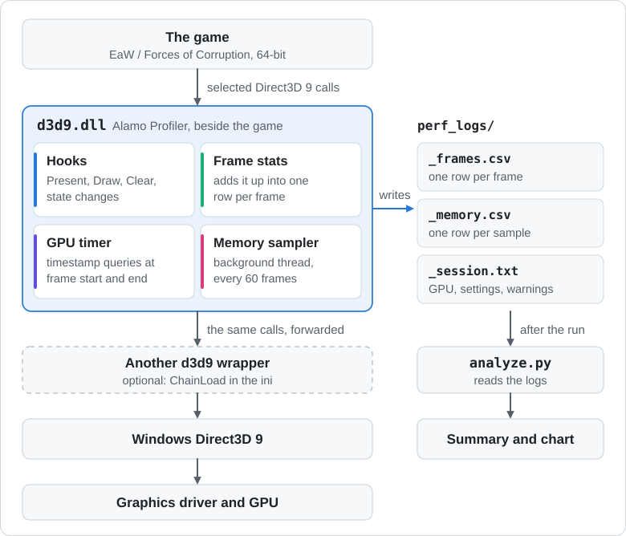
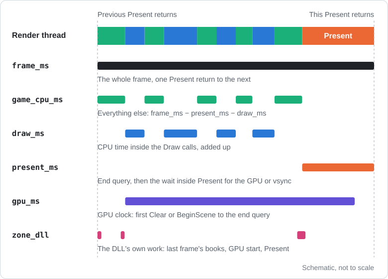
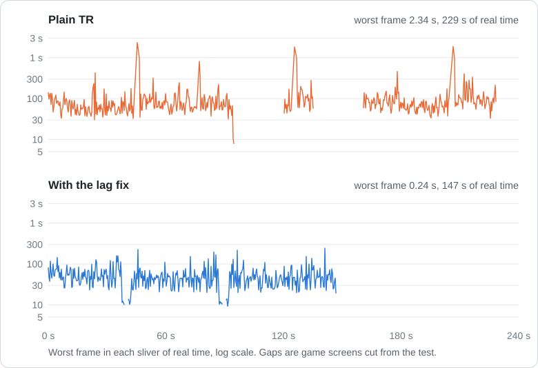
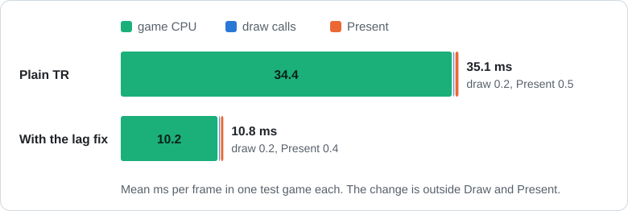
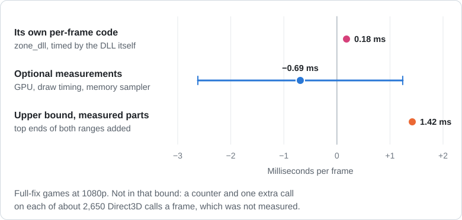

# Alamo Profiler

Alamo Profiler is a Direct3D 9 timing DLL for the 64-bit Steam builds of
Star Wars: Empire at War and Forces of Corruption only. It forwards Direct3D
calls to the Windows runtime, records one CSV row per rendered frame, and
writes a session text file. It also samples process memory usage in a
background thread. It does not require changes to the game's data files.

**Single-player only. Do not use it in multiplayer.**

## How it works

The game loads this `d3d9.dll` instead of the Windows one. The DLL loads the real
Direct3D, hands the game the real objects, and swaps the entries in the device's
method table for its own timed versions. Each hook does its small piece of
bookkeeping and calls the original, so the game's calls reach the driver unchanged.
Methods it doesn't hook keep their original entries and go straight to Direct3D.

<picture>
  <source media="(prefers-color-scheme: dark)" srcset="docs/img/how-it-fits-dark.svg">
  
</picture>

Every frame runs from one `Present` return to the next. This is where each CSV
column comes from:

<picture>
  <source media="(prefers-color-scheme: dark)" srcset="docs/img/one-frame-dark.svg">
  
</picture>

## Install

1. Close the game.
2. Copy the built `d3d9.dll` and `alamo_profiler.ini` into the folder of the
   executable the game actually runs. For Steam Forces of Corruption this
   is the `corruption` folder, rather than the launcher folder.
3. Start a single-player game. Logs appear in `perf_logs` beside the DLL.
   Press F11 to mark a frame while measuring.

If that folder already contains a `d3d9.dll`, preserve it. Rename the existing
wrapper to something such as `d3d9_next.dll`, then set
`ChainLoad=d3d9_next.dll` in the INI before copying this profiler's DLL into
place. The other wrapper must also be 64-bit. Never set `ChainLoad` to this
profiler's own DLL. An empty setting loads `d3d9.dll` from the Windows system
directory.

To uninstall, close the game and remove this profiler's `d3d9.dll` and
`alamo_profiler.ini`. If you renamed an existing wrapper, restore its original
name. The generated `perf_logs` directory can be kept or deleted.

## Settings

Settings are read once from `alamo_profiler.ini` beside the DLL. All keys are
optional and belong in `[alamo_profiler]`. Relative paths start at the DLL's
folder. Integer values accept decimal or `0x` hexadecimal notation.

| Key | Default | Meaning |
| --- | --- | --- |
| `Enabled` | `1` | `0` forwards calls without hooks or output files. |
| `FramesCsv` | `1` | `0` disables the frame CSV and memory sidecar; hooks and the session text file remain enabled. |
| `GpuTiming` | `1` | Enable GPU timestamp queries for `gpu_ms`. |
| `DrawTiming` | `1` | Time each Draw call on the CPU, at a cost of two clock reads per draw. Counters remain active when disabled. |
| `FlushEvery` | `120` | Frames between draining and flushing the frame CSV; values below 1 become 1. Smaller values reduce buffered data at the cost of more writes. |
| `MemoryEvery` | `60` | Frames between background memory sampling requests. Values below 1 disable sampling. Requires `FramesCsv=1`. |
| `MarkerKey` | `0x7A` | Windows virtual-key code for a frame mark; the default is F11. `0` disables it. A press adds one mark, rather than repeating while held. |
| `OutputDir` | `perf_logs` | Output directory, absolute or relative to the DLL. The directory itself is created if needed; create parent directories yourself for nested paths. |
| `ChainLoad` | empty | DLL to receive forwarded calls. Empty selects the Windows system Direct3D 9 runtime. |

## Output

Files share a local-time name such as `20261031_120000_frames.csv`,
`20261031_120000_memory.csv`, and `20261031_120000_session.txt`.
Avoid starting two sessions in the same output directory within one second.

The first completed Present establishes the CSV clock and discards loading
work accumulated before it. Frame 1 ends at the next completed Present.
Frame numbers and the clock continue across device recreation. The session
file uses milliseconds since profiler initialization and records the first
Present's clock origin, allowing those timestamps to be aligned with CSV
`t_ms`.

The frame CSV has these columns, in this order:

| Column | Unit | Meaning |
| --- | --- | --- |
| `frame` | frame number | Closed frame, starting at 1. |
| `t_ms` | ms | End of frame relative to the first completed Present. |
| `frame_ms` | ms | Time from the previous Present's return to this Present's return. |
| `present_ms` | ms | Present interval measured around the runtime call, including its waits and adjacent GPU query bookkeeping. Vsync can dominate it. |
| `draw_ms` | ms | Sum of CPU time inside `DrawPrimitive`, `DrawIndexedPrimitive`, `DrawPrimitiveUP`, and `DrawIndexedPrimitiveUP`; zero when draw timing is disabled. |
| `game_cpu_ms` | ms | `max(0, frame_ms - present_ms - draw_ms)`. Includes all remaining work and waits; it does not isolate simulation time. |
| `gpu_ms` | ms | GPU timestamp span from the first Clear or BeginScene through the end-of-frame query. Blank when disabled, unsupported, invalid, or unavailable in time. |
| `draws` | calls/frame | Total calls to the four Draw methods listed above. |
| `prims` | primitives/frame | Sum of their requested primitive counts. |
| `set_texture` | calls/frame | `SetTexture` calls. |
| `set_render_state` | calls/frame | `SetRenderState` calls. |
| `set_shader` | calls/frame | `SetVertexShader` plus `SetPixelShader` calls. |
| `set_stream` | calls/frame | `SetStreamSource` calls. |
| `set_const` | calls/frame | `SetVertexShaderConstantF` plus `SetPixelShaderConstantF` calls. |
| `set_rt` | calls/frame | `SetRenderTarget` calls. |
| `clears` | calls/frame | `Clear` calls. |
| `scenes` | calls/frame | `BeginScene` calls. |
| `marks` | marks/frame | Marker-key presses observed at this frame boundary. |
| `zone_dll` | ms | Profiler self-time from Present-hook work, frame-start GPU bookkeeping, and frame-end bookkeeping. Excludes time inside the real Present; frame-end bookkeeping is charged to the next frame. This overlaps other timing buckets. |

Counters count calls, including calls that fail. State-block recording uses
the runtime's recording table, so recorded state calls do not enter these
counters. Rows are drained every `FlushEvery` frames and written in frame
order. A row can be written without a GPU result once ten later frames have
closed. Closed rows are also flushed on device release and
shutdown. The tool intercepts the executable's imported `TerminateProcess`
to flush when the game exits through that path. A crash or external forced
termination can still lose buffered data.

The memory sidecar has these columns:

| Column | Unit | Meaning |
| --- | --- | --- |
| `frame` | frame number | Frame that requested the sample; joins to the frame CSV. |
| `t_ms` | ms | That frame's timestamp on the same CSV clock. |
| `private_bytes` | bytes | Process private memory usage sampled by Windows; zero if unavailable. |
| `largest_free_bytes` | bytes | Largest allocation-aligned free virtual-memory block found. |
| `regions` | queries/sample | Number of virtual-memory region queries, including a failed query. |
| `truncated` | boolean, 0/1 | `1` means the virtual-memory walk was incomplete. Its largest-free result is only a partial result. |
| `sample_ms` | ms | Time spent obtaining private bytes and walking virtual-memory regions; excludes writing the row. |

Memory is sampled after a frame requests it; the sample is not an exact
snapshot at Present. A busy sampler keeps only the newest pending request,
so some requested frames may be absent. It reads Windows memory statistics
and allocation metadata, without inspecting game data. The session text
file includes adapter details, presentation settings, warnings, clock origin,
memory sampling costs, and shutdown information.

The hooks assume a single rendering thread and warn if a different thread
is observed. Direct3D 9 and 9Ex creation exports are forwarded; `PresentEx`
is not timed. The intended game uses the ordinary Present path.

## Analyze a run

Python 3.9 or newer is needed for analysis. No Python packages are needed for
text summaries:

```text
python tools/analyze.py perf_logs/20261031_120000_frames.csv --no-chart
python tools/analyze.py perf_logs/20261031_120000_frames.csv --window 1000 3000
```

The script prints a summary and writes a sibling `_summary.txt` file. It
automatically reads the matching memory and session files if present.
`--window START END` selects an inclusive frame range. `--memory PATH`
selects another memory CSV. `--hitch-mult` (default 2) and `--hitch-floor-ms`
(default 33.333...) set the hitch rule: a frame must exceed both thresholds.
Install optional `matplotlib` with `python -m pip install matplotlib` to
write a `_chart.png` file when `--no-chart` is omitted.

`tools/cmp_runs.py` also compares frame-time windows across runs:

```text
python tools/cmp_runs.py repeat baseline=baseline_frames.csv trial=trial_frames.csv
```

## What a capture looks like

Two views of real captures: *Forces of Corruption* with the Thrawn's Revenge mod on
its galactic map, one test game without a lag fix and one with it.

<picture>
  <source media="(prefers-color-scheme: dark)" srcset="docs/img/capture-trace-dark.svg">
  
</picture>

<picture>
  <source media="(prefers-color-scheme: dark)" srcset="docs/img/capture-split-dark.svg">
  
</picture>

That split is the kind of answer the tool is for: nearly all of this frame time, and
of the improvement, sits outside the timed Draw and Present calls, so that's where to
look first. `game_cpu_ms` is everything left over, so it can't say more than that.

## What it costs

A timer is part of what it measures. I tested the cost in 26 games at 1920×1080 with
the same DLL's timing code, half with `GpuTiming`, `DrawTiming` and the memory
sampler off.

<picture>
  <source media="(prefers-color-scheme: dark)" srcset="docs/img/cost-dark.svg">
  
</picture>

Those games ran the private build this one was cut from, which also carries a command
channel, on a machine busy enough to widen the range. This timer-only build hasn't had
its own cost test; it does the same per-frame timing work with less around it, and adds one fix so GPU timing comes back after a failed `Reset`. `zone_dll` reports
its own per-frame code in every capture you make.

## Build and test

Use CMake 3.20 or newer (for `ctest --test-dir`), a C++17 compiler, and Windows SDK Direct3D 9 headers.
From this directory, with MSVC installed:

```text
cmake -S . -B build -A x64
cmake --build build --config Release
ctest --test-dir build -C Release --output-on-failure
python -I -B -m unittest discover -s tools
```

The installable DLL is `build/Release/d3d9.dll`. CTest runs the frame stats,
memory formatting/walk, deferred logging, analysis (when Python is found),
and Windows rendering smoke tests. The smoke test renders a triangle, checks
counters and memory samples, and checks device-release and process-exit
flushing. Run it manually from its output directory if needed:

```text
cd build/Release
smoke_d3d9.exe
```

The smoke test temporarily writes and restores its own INI beside the test
executable and leaves test logs there. Run it from the build output, away
from a game installation.

With a 64-bit MinGW toolchain on PATH:

```text
cmake -S . -B build-mingw -G "MinGW Makefiles"
cmake --build build-mingw
ctest --test-dir build-mingw --output-on-failure
```

On a non-Windows host, only the portable unit tests and analysis tests build:

```text
cmake -S . -B build-host
cmake --build build-host
ctest --test-dir build-host --output-on-failure
python -I -B -m unittest discover -s tools
```

## License

MIT. See [LICENSE](LICENSE).
